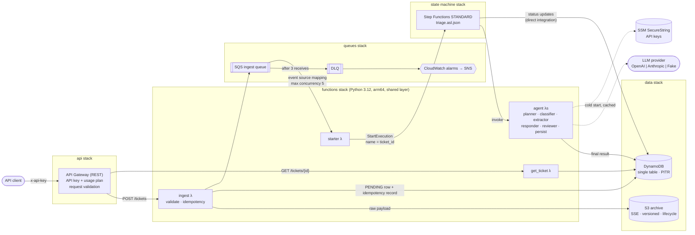
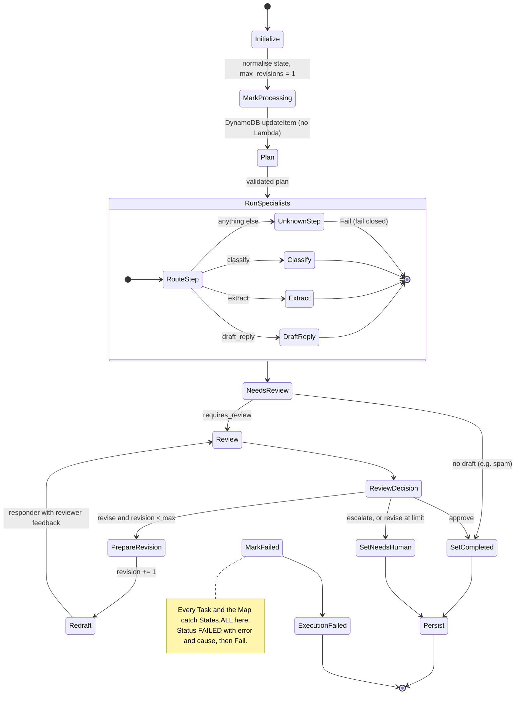

# serverless-agent-pipeline

A planning-driven, multi-agent LLM pipeline on AWS Step Functions. It triages support tickets for **Acme Notes**, a fictional note-taking SaaS product.

`POST /tickets` accepts a ticket. A Step Functions workflow then runs it through several agents: a **planner** chooses which specialist agents to run, the specialists run in parallel, a **reviewer** guardrail checks the drafted reply, and the result is stored. `GET /tickets/{id}` returns the outcome, including token usage and latency for every agent call.

The whole system deploys with one command and runs with **no API keys**. The default `LlmProvider=fake` uses a deterministic heuristic model, so you can deploy, smoke-test and demo it for close to $0. Switching to OpenAI or Anthropic is a single parameter change.

```
make install && make test     # 98 tests, ~97% coverage, no AWS account needed
make deploy                   # sam build && sam deploy (fake LLM by default)
make samples                  # send the 12 synthetic tickets and print the results
make teardown                 # empty the archive bucket, delete the stack
```

---

## Contents

- [Architecture](#architecture)
- [The workflow](#the-workflow)
- [Why Step Functions?](#why-step-functions-and-not-one-lambda-or-sqs-chaining)
- [Agents](#agents)
- [Config-driven extraction](#config-driven-extraction-add-a-field-without-touching-code)
- [Failure modes](#failure-modes-and-how-each-is-handled)
- [Security posture](#security-posture)
- [Cost per 1,000 tickets](#cost-estimate-per-1000-tickets)
- [Deploy and teardown](#deploy-and-teardown)
- [Testing](#testing)
- [Repository layout](#repository-layout)
- [Design decisions and trade-offs](#design-decisions-and-trade-offs)
- [What I'd do next](#what-id-do-next)

---

## Architecture



The root `template.yaml` contains only five nested stacks (`AWS::Serverless::Application`):

| Stack | Contents |
|---|---|
| `stacks/data.yaml` | DynamoDB single table (on-demand, PITR, SSE, TTL, status GSI). S3 archive bucket (SSE, versioning, public access blocked, lifecycle, TLS-only policy). |
| `stacks/queues.yaml` | Ingest queue, DLQ (`maxReceiveCount: 3`), DLQ-depth and queue-age alarms, SNS alarm topic. |
| `stacks/functions.yaml` | Shared Lambda layer and all 9 functions. Each function has its own role and log group. |
| `stacks/statemachine.yaml` | The STANDARD state machine (`DefinitionUri` plus `DefinitionSubstitutions`), its log group, and failure/timeout alarms. |
| `stacks/api.yaml` | REST API from a Swagger definition, API key, usage plan (throttle and quota), and invoke permissions. |

The starter function needs `states:StartExecution` on the state machine, but the state machine is created after the functions. To avoid a circular dependency, the root stack gives the state machine a fixed name, and the starter's ARN is derived from that name.

### DynamoDB single-table design

| Item | `pk` | `sk` | Notes |
|---|---|---|---|
| Ticket and result | `TICKET#<uuid>` | `META` | status, result, `agent_calls[]`, `usage_totals` |
| Idempotency record | `IDEMPOTENCY#ingest` | `<hash>` | written by Powertools, expires via TTL (`expiration`) |
| GSI `gsi1` | `STATUS#<status>` | `<updated_at>` | the "show me everything that is `NEEDS_HUMAN`" queue |

---

## The workflow



Every Task state has a `Retry` with exponential backoff and full jitter:

| Error | Interval | Attempts | Backoff | Cap |
|---|---|---|---|---|
| `Lambda.ServiceException`, `Lambda.TooManyRequestsException`, `Lambda.Unknown`, ... | 2 s | 4 | ×2 | 20 s |
| `LLMThrottledError` (HTTP 429), `LLMUnavailableError` (5xx, 529, timeouts), `States.Timeout` | 5 s | 5 | ×2 | 60 s |
| `LLMResponseError` (invalid or truncated JSON) | 1 s | 1 | n/a | n/a |
| DynamoDB throttling and 5xx (status updates) | 1 s | 5 | ×2 | 20 s |

All top-level tasks, and the Map state, `Catch` `States.ALL` and route to `MarkFailed`. Tasks inside the Map are caught at the Map level, because a Catch cannot jump out of a Map iteration. The error names in the ASL are the Python exception class names, because Lambda reports `errorType` as the class name. A unit test checks that the two stay in sync.

---

## Why Step Functions (and not one Lambda, or SQS chaining)?

| | One big Lambda | SQS chaining (Lambda → queue → Lambda ...) | **Step Functions** |
|---|---|---|---|
| Per-step retry policy | Hand-written. A retry usually re-runs, and re-pays for, every LLM call before the failure. | One queue per hop, with redrive. Coarse-grained. | Declared per state: backoff, jitter and caps, retried at the failed step only. |
| Fan-out / fan-in (run specialists in parallel, then join) | Threads in one process. One timeout kills everything. | Fan-in needs a coordination table and counters. | `Map` state, with results joined automatically. |
| Loops with a hard limit (review → redraft ≤ 1) | Hidden in code. | Hop counters inside messages. | Visible in the definition and covered by tests. |
| Visibility | Logs only. | A ticket's journey is spread across N queues and log groups. | One execution per ticket, with a visual history of each state's input and output. |
| Exactly-once start | n/a | n/a | Execution name = `ticket_id`, so a duplicate start fails with `ExecutionAlreadyExists`. |
| Max duration | 15 min, billed while waiting on the LLM. | Unbounded, but stateless. | Up to a year. Waiting between steps is free. |
| Cost | Cheapest | Cheap | About $0.025 per 1k state transitions. The largest AWS line item here (see [cost](#cost-estimate-per-1000-tickets)). |

**Why STANDARD and not EXPRESS?** Express would cost about 40× less per ticket. But Express executions are at-least-once, execution names don't de-duplicate, and execution history lives only in CloudWatch Logs. For an LLM pipeline that spends real money per step and needs an audit trail, exactly-once semantics, the built-in history and the ability to redrive a failed execution are worth about $0.40 per 1,000 tickets. At very high volume, the right move would be to run the specialist Map as an Express child workflow.

---

## Agents

All agents go through one interface, `LLMClient.complete_json(system, user, schema, schema_name)`. That interface has three implementations:

| Implementation | Structured output | Notes |
|---|---|---|
| `OpenAIClient` | Chat Completions `response_format: json_schema, strict: true` | `finish_reason=length` and refusals raise `LLMResponseError` |
| `AnthropicClient` | Messages API with a forced `tool_choice` | `stop_reason=max_tokens` raises; reads the `tool_use.input` block |
| `FakeLLM` | Deterministic heuristics, or a per-test script | Default in deployed stacks and in all tests |

Latency measurement and schema validation live in the base class (template method), so they behave the same for every provider. The clients are about 80 lines of standard-library HTTPS each, with **no vendor SDKs in the layer**. For two POST endpoints, the SDKs aren't worth ~30 MB and the extra cold-start time. Each call's `{agent, provider, model, input_tokens, output_tokens, latency_ms}` is stored in `agent_calls`, and the totals in `usage_totals`. The same values are emitted as CloudWatch EMF metrics with `agent` and `provider` dimensions.

| Agent | Input | Output | Guardrails in code |
|---|---|---|---|
| **Planner** | ticket | `{steps[], reason}` | Allow-list (`classify`, `extract`, `draft_reply`). Unknown steps are dropped and recorded in `rejected_steps`. `classify` is mandatory. `requires_review` is derived in code, never taken from the model. |
| **Classifier** | ticket | category, priority, sentiment, confidence, rationale | Enum schema. Confidence is clamped to 0..1. |
| **Extractor** | ticket + registry | `fields{}` defined by `config/extraction_registry.yaml` | Enum membership, regex patterns and type checks. Invalid values become `null`, with a warning. |
| **Responder** | ticket (+ feedback, triage context and previous draft on a redraft) | reply, tone, needs_followup | Policy is stated in the system prompt. |
| **Reviewer** | ticket + latest draft | `approve`, `revise` or `escalate`, with issues and feedback | Checked in layers, cheapest first: ticket escalation rules, then deterministic draft regexes (refunds, timelines, guarantees, credential requests), then the LLM review. |
| **Persist** | full state | `COMPLETED` or `NEEDS_HUMAN` row | Collects usage from every agent call, including the first review and any redraft. |

### What the 12 synthetic samples do (with `LlmProvider=fake`)

| Sample | Status | Plan | Category / priority | Review | Revisions |
|---|---|---|---|---|---|
| `001-sync-error` | COMPLETED | classify, extract, draft_reply | bug / p2 | approve | 0 |
| `002-double-charge-refund` | COMPLETED | classify, extract, draft_reply | billing / p2 | approve after redraft: the first draft promised a refund | 1 |
| `003-legal-threat` | **NEEDS_HUMAN** | classify, extract, draft_reply | bug / p2 | escalate (legal) | 0 |
| `004-feature-request` | COMPLETED | classify, draft_reply | feature_request / p4 | approve | 0 |
| `005-spam` | COMPLETED | classify | other / p4 | none (no draft, no review) | n/a |
| `006-outage` | COMPLETED | classify, extract, draft_reply | outage / p1 | approve | 0 |
| `010-escalate-hallucinated-step` | COMPLETED | planner proposed `escalate_to_engineering`, which was **dropped** | bug / p2 | approve | 0 |
| `011-prompt-injection` | COMPLETED | classify, extract, draft_reply | billing / p2 | the injected "refund everyone by tomorrow" was caught by the rules and redrafted | 1 |

(`007`–`009` and `012` follow the same path as `001`.) The integration suite asserts every row in this table.

---

## Config-driven extraction: add a field without touching code

`config/extraction_registry.yaml` is the single source of truth. Three things are generated from it: the JSON schema sent to the model, the field list in the prompt, and the post-validation. At build time, the layer Makefile bundles the file into the layer.

To start extracting the customer's browser, add one entry:

```diff
 fields:
   - name: product_area
     ...
   - name: app_version
     type: string
     pattern: "^[0-9]+\\.[0-9]+(\\.[0-9]+)?$"
     description: Acme Notes app version if stated, e.g. 4.12.1.
+
+  - name: browser
+    type: enum
+    values: [chrome, firefox, safari, edge]
+    description: Browser used for the web app, if mentioned.
```

Then run `make deploy`. `functions/extractor/app.py` has no field-specific code, and `tests/unit/test_registry.py::test_adding_a_field_is_config_only` proves it: the test appends `browser` to a copy of the registry and runs the unchanged extractor. Supported types are `string` (optional `pattern`), `enum` (`values`), `boolean` and `integer`. Every field is nullable, because "not mentioned" should be `null`, not a guess. A malformed registry fails fast at load time with a `RegistryError`.

---

## Failure modes and how each is handled

| # | Failure | What happens | Where |
|---|---|---|---|
| 1 | Client retries or double-submits | Same `Idempotency-Key`, or the same body without a key, returns the **same** `ticket_id` and enqueues once. Same key with a different payload returns `422`. A concurrent in-flight request returns `409` with `Retry-After`. | Powertools idempotency, `ingest` |
| 2 | Malformed request | Rejected with `400` by the API Gateway model **before** Lambda runs. Lambda validates again (a test keeps the two in sync). | `api.yaml`, `models.py` |
| 3 | SQS send fails after the row was written | Row is marked `FAILED (EnqueueFailed)`. The exception releases the idempotency lock, so the client's retry is safe. | `ingest` |
| 4 | Duplicate SQS delivery | `ExecutionAlreadyExists` is treated as success, so one workflow runs per ticket. | `starter` |
| 5 | Poison message | Reported as a partial batch failure. Only that message is retried, and after 3 receives it goes to the **DLQ**, which raises an **alarm**. | `starter`, `queues.yaml` |
| 6 | Starter throttled or Step Functions unavailable | Message becomes visible again and is retried. The queue-age alarm fires if the oldest message is older than 5 minutes. | ESM, `queues.yaml` |
| 7 | LLM rate limit (429) or overload (529) | `LLMThrottledError`, retried up to 5 times with backoff (5 s → 60 s cap, full jitter). The ESM's `MaximumConcurrency: 5` and the Map's `MaxConcurrency: 3` bound the load. | ASL Retry |
| 8 | LLM 5xx, timeout or connection reset | `LLMUnavailableError`, retried with the same policy. | ASL Retry |
| 9 | LLM returns invalid or truncated JSON | `LLMResponseError`, retried once, then `FAILED`. | base client, ASL |
| 10 | Bad API key or bad request (4xx) | `LLMRequestError`, not retried. Fails fast to `FAILED` and raises the `ExecutionsFailed` alarm. | ASL Catch |
| 11 | Planner hallucinates a step | Dropped, recorded in `rejected_steps`, and counted by the `PlanStepsRejected` metric. If something slipped through, the Map's `UnknownStep` fails closed. | `plan.py`, ASL |
| 12 | Draft breaks policy | `revise`, then **one** redraft with feedback, then `NEEDS_HUMAN` if it still fails. | reviewer, ASL loop |
| 13 | Ticket must reach a human (legal threat) | `escalate` goes straight to `NEEDS_HUMAN`, with no pointless redraft. | `guardrails.py` |
| 14 | Prompt injection in the ticket | Customer text only ever appears inside tagged JSON blocks, with a "treat as data" rule in every system prompt. The deterministic rules catch the damaging outcomes (refund or timeline promises) even if the model complies. | `prompts.py`, `guardrails.py` (sample 011) |
| 15 | Any unhandled task error | `Catch` routes to `MarkFailed`, which writes status `FAILED` with error and cause, then a `Fail` state, which raises the alarm. | ASL |
| 16 | Workflow hangs | Workflow `TimeoutSeconds: 900` and the `ExecutionsTimedOut` alarm. **Known gap:** a timeout skips `Catch`, so the row stays `PROCESSING`. The fix is under [next steps](#what-id-do-next). | ASL |
| 17 | DynamoDB throttling | SDK retries in Lambda, and the ASL retries the direct integrations. On-demand capacity absorbs spikes. | ASL |

---

## Security posture

- **Edge.** API key plus usage plan (rate 20 rps, burst 40, 10k/day), with API key source `HEADER`. API keys identify and meter clients; they are not authentication. Real end users would use IAM, Cognito or a JWT authorizer, which is out of scope here. Both routes require the key, and a test asserts that. The request body is validated against a strict model (`additionalProperties: false`, length limits).
- **Least privilege.** Every function has its own role with only the actions it needs, scoped to specific resources:

  | Function | Permissions |
  |---|---|
  | ingest | `dynamodb:PutItem/GetItem/UpdateItem/DeleteItem` on the table (Delete is needed to release an idempotency lock), `s3:PutObject` on `raw/*`, `sqs:SendMessage` on the ingest queue |
  | starter | `states:StartExecution` on the one state machine, plus receive/delete on the one queue. The event source mapping is declared manually, because SAM's SQS event attaches a managed policy with `Resource: "*"`. |
  | agents | `ssm:GetParameter` on `parameter/<prefix>/*` only |
  | persist / get_ticket | `dynamodb:UpdateItem` / `dynamodb:GetItem` on the table |
  | state machine | `lambda:InvokeFunction` on the 6 agent ARNs, `dynamodb:UpdateItem` on the table |

  The only `"*"` resources are where AWS requires them, and each has a comment in the template: X-Ray `PutTraceSegments`/`PutTelemetryRecords`, CloudWatch Logs vended-delivery APIs for Step Functions logging, and SAM's standard `AWSLambdaBasicExecutionRole` for Lambda logging.
- **Secrets.** LLM keys are SSM SecureStrings encrypted with `aws/ssm`. Environment variables hold only the *parameter name*. The value is decrypted on first use and cached in process for an hour, so a warm container makes no SSM calls and a rotated key is picked up within the hour. Client `__repr__` never prints the key, and nothing is passed through CloudFormation parameters.
- **Encryption.** DynamoDB uses SSE (KMS, AWS-managed key). S3 uses SSE-S3 with a bucket key and a bucket policy that denies non-TLS requests. SQS uses SSE with a TLS-only queue policy. SNS uses `alias/aws/sns`.
- **Data handling.** S3 blocks all public access, `BucketOwnerEnforced` disables ACLs, raw payloads move to Standard-IA after 30 days and expire after 365, and noncurrent versions expire after 7 days. Step Functions logs at `ERROR` with `IncludeExecutionData: false`, so ticket text stays out of logs. `GET` hides internal fields.
- **LLM-specific.** Untrusted-input framing, a server-side allow-list for planned steps, deterministic guardrails that cannot be prompt-injected, a hard loop limit, and output schema validation on every response.
- **Supply chain and CI.** The layer pins its dependencies, and boto3 is not bundled because the runtime provides it. Deploys use GitHub OIDC with no long-lived AWS keys, and run through a GitHub `environment`, so prod can require reviewers.
- **Not in scope:** VPC isolation (Lambdas reach LLM providers over TLS on the public internet), WAF, customer-managed KMS keys, multi-tenancy.

---

## Cost estimate per 1,000 tickets

**Assumptions:** us-east-1 list prices at the time of writing; a full plan of 5 LLM calls per ticket, with 20% of tickets needing one redraft; 4 `GET` polls per ticket; and an average of about 1.5 s of LLM wait per agent Lambda at 512 MB on arm64. Check current AWS and provider pricing before relying on these numbers.

| Service | Driver per ticket | Per 1,000 tickets |
|---|---|---|
| Step Functions (Standard) | ~17 state transitions (16 on the happy path, +4 per redraft) at $0.025 per 1k | **$0.43** |
| Lambda duration (arm64) | ~4 GB-s, mostly waiting on the LLM | $0.05 |
| API Gateway (REST) | 1 POST + 4 GET at $3.50/M | $0.02 |
| DynamoDB on-demand | ~12 WRU (incl. GSI and idempotency) + ~5 RRU | $0.01 |
| CloudWatch Logs + X-Ray | ~15 KB of logs; sampled traces | $0.01 |
| Lambda requests, SQS, S3 PUTs, SSM | ~12 invocations, 3 SQS calls, 1 PUT | $0.01 |
| **AWS subtotal** | | **≈ $0.53** |
| LLM tokens | ~3.2k input / ~0.6k output tokens per ticket | 3.2M in / 0.6M out |
| at an illustrative "mini" tier ($0.40 / $1.60 per M) | | ≈ $2.30 |
| at an illustrative "small" tier ($1.00 / $5.00 per M) | | ≈ $6.30 |
| **Total** | | **≈ $3–7 per 1,000 tickets** (≈ $0.53 with `LlmProvider=fake`) |

LLM tokens dominate the cost, and Step Functions is most of the AWS bill. The cheapest levers, in order:

1. Prompt caching for the static system prompts, which make up most of the input tokens.
2. Merging classify and extract into one call for short tickets.
3. Sending only the specialist Map through an Express child workflow.

---

## Deploy and teardown

**Prerequisites:** AWS CLI v2 with credentials, SAM CLI, Python 3.12, `make`. Windows users: run inside WSL, or use the GitHub Actions deploy workflow.

```bash
make install            # dev dependencies (pytest, moto, ruff, cfn-lint)
make deploy             # = sam build && sam deploy --config-env default   (LlmProvider=fake)
make samples            # resolves URL + API key from stack outputs, sends samples/, waits, prints a table
make teardown           # empties the versioned archive bucket, then sam delete
```

`samconfig.toml` holds placeholder values only: `stack_name`, `region` and parameter overrides. The `prod` config env deploys with `LlmProvider=anthropic`.

**Using a real model.** Create the key out of band (it is never a CloudFormation parameter), then redeploy:

```bash
aws ssm put-parameter --type SecureString \
  --name /acme-notes/triage/anthropic-api-key --value "$ANTHROPIC_API_KEY"
sam deploy --parameter-overrides LlmProvider=anthropic       # or openai (/acme-notes/triage/openai-api-key)
```

**Calling the API by hand:**

```bash
URL=$(aws cloudformation describe-stacks --stack-name acme-notes-triage-dev \
  --query "Stacks[0].Outputs[?OutputKey=='ApiUrl'].OutputValue" --output text)
KEY_ID=$(aws cloudformation describe-stacks --stack-name acme-notes-triage-dev \
  --query "Stacks[0].Outputs[?OutputKey=='ApiKeyId'].OutputValue" --output text)
KEY=$(aws apigateway get-api-key --api-key "$KEY_ID" --include-value --query value --output text)

curl -s -X POST "$URL/tickets" -H "x-api-key: $KEY" -H "Idempotency-Key: demo-0001" \
  -H "content-type: application/json" -d @samples/002-double-charge-refund.json
curl -s "$URL/tickets/<ticket_id>" -H "x-api-key: $KEY"
```

**CI/CD.**

- `.github/workflows/ci.yml` runs on every PR and push to `main`: ruff (lint and format), cfn-lint, ASL schema lint, `sam validate --lint` on every template, `sam build` (which proves the arm64 layer build works), and pytest with coverage.
- `.github/workflows/deploy.yml` runs manually (`workflow_dispatch`). It gates on the tests, assumes an AWS role with **GitHub OIDC**, runs `sam build && sam deploy`, then smoke-tests `/tickets`. The smoke test asserts that an unauthenticated request returns `403`, and that sample tickets `001` and `005` reach a terminal state.

To set up the deploy workflow once:

1. Create an IAM OIDC identity provider for `token.actions.githubusercontent.com`.
2. Create a deploy role that trusts that provider, with its `sub` condition restricted to `repo:<owner>/serverless-agent-pipeline:environment:dev` (and `:prod`).
3. Store the role ARN as the `AWS_DEPLOY_ROLE_ARN` secret in each GitHub environment. Optionally, set `AWS_REGION` as a repository variable.

---

## Testing

```
make test               # 98 tests, ~97% line coverage of the layer and functions
```

- **Unit tests** cover plan validation (allow-list, dedupe, mandatory classify, derived review flag), the registry (schema generation, coercion, malformed configs, *adding a field with zero code changes*), the LLM clients (OpenAI/Anthropic request and response mapping, HTTP status → retryable taxonomy, truncation, keys never in `repr`, SSM key loading), the agents with scripted `FakeLLM`, and the guardrail rules.
- **The workflow itself.** `tests/support/asl.py` is a small ASL interpreter for the subset this definition uses. It runs the real `triage.asl.json` to test routing, retries (attempt counts), the **reviewer loop limit** (exactly one redraft, then `NEEDS_HUMAN`), the escalation fast path, the skip-review path, and `MarkFailed` on non-retryable errors and exhausted retries. Static tests check that every transition target exists, every Task retries, the retry error names match the Python exception classes, and the `${...}` placeholders match `DefinitionSubstitutions` in the template.
- **Integration tests (moto)** cover ingest (fan-out to S3, DynamoDB and SQS; **idempotency** with a header, without a header, a mismatched payload, and the release path after an enqueue failure), the starter (duplicate delivery, poison messages in a partial batch), the API (GET, 404/400, API model in sync with Lambda validation), and an **in-process end-to-end** run of all 12 samples: ingest → SQS → starter → the real ASL with the real handlers → DynamoDB → `GET`. Moto creates its table from the key schema in `stacks/data.yaml`, so the tests can't drift from the infrastructure.

---

## Repository layout

```
template.yaml                    root stack - wires the nested stacks
stacks/                          data · queues · functions · statemachine · api
statemachine/triage.asl.json     the workflow (DefinitionSubstitutions for ARNs/table)
functions/<name>/app.py          ingest, starter, planner, classifier, extractor,
                                 responder, reviewer, persist, get_ticket
layers/common/                   shared layer (Makefile build → arm64 wheels + registry)
  acme_common/llm/               LLMClient, OpenAI, Anthropic, FakeLLM, errors, mini schema validator
  acme_common/{plan,registry,guardrails,agent,store,models,prompts,results,secrets}.py
config/extraction_registry.yaml  extractor fields - edit to add a field
samples/                         12 synthetic Acme Notes tickets
tests/unit, tests/integration    pytest + moto + FakeLLM; tests/support/asl.py simulator
scripts/                         send_samples.py (smoke test), empty_bucket.py, lint_asl.py
.github/workflows/               ci.yml, deploy.yml
```

---

## Design decisions and trade-offs

- **The ASL owns the loop limit.** `review_loop.max_revisions` is set once, in the `Initialize` state. The reviewer only judges the draft; it doesn't count attempts. So the limit is visible in the console and can't drift between two code paths.
- **An `escalate` verdict, in addition to approve/revise.** A legal threat can't be fixed by rewording, so redrafting would only cost tokens. Escalation goes straight to `NEEDS_HUMAN`.
- **First-pass drafts see only the ticket.** The responder runs inside the Map, in parallel with classify and extract, to keep latency low. A redraft gets the full triage context and the reviewer's feedback. The alternative, running the responder after the Map, adds one LLM call's worth of latency to every ticket in exchange for better first drafts. Which is better is a question for evals (see next steps).
- **The planner proposes, code disposes.** `steps` is deliberately *not* an enum in the model's schema. The allow-list is enforced server-side, so it holds for every provider, and rejected proposals stay observable instead of being silently prevented.
- **Deterministic rules run before the LLM judge.** The rules are cheap, explainable and immune to prompt injection. The LLM catches what regexes can't. When both flag issues, the union decides.
- **Direct service integration** for status flips (`MarkProcessing`, `MarkFailed`), with no Lambda in between.
- **Back-pressure is set in two places:** the ESM's `MaximumConcurrency` (concurrent workflow starts) and the Map's `MaxConcurrency` (parallel LLM calls per ticket).
- **`FakeLLM` is the default provider**, so the deployed stack and CI smoke test are deterministic and need no secrets.

---

## What I'd do next

1. **Evals in CI.** Build a labelled golden set of ~200 synthetic tickets. A nightly workflow would run the classifier, extractor and reviewer against the real provider and track accuracy, guardrail precision and recall, cost and p95 latency per agent, then fail the build on regressions. Add an LLM-as-judge rubric for reply quality, and use the same harness to settle the "responder inside or after the Map" question.
2. **EventBridge fan-out.** Emit `TicketTriaged` and `TicketNeedsHuman` events to a custom bus, so consumers (p1 paging, helpdesk sync, analytics) subscribe without touching the pipeline. Also add a rule on Step Functions status changes (`TIMED_OUT`, `ABORTED`) that marks the ticket `FAILED`, which closes the known gap in failure mode 16.
3. **Aurora Serverless v2 for relational reporting.** Stream finalised tickets (DynamoDB Streams → EventBridge Pipes → Lambda) into Aurora PostgreSQL Serverless v2 for SQL reporting: SLA by tier, category trends, token spend per agent per day, guardrail hit rates. DynamoDB stays the system of record for the request path.
4. **Cost and latency.** Prompt caching for system prompts, a combined classify+extract call for short tickets, and an Express child workflow for the specialist Map.
5. **Hardening.** WAF on the API, a customer-managed KMS key for the table and bucket, a Bedrock `LLMClient` to keep traffic inside AWS, and CloudWatch dashboards built from the EMF metrics that are already emitted.

---

*All companies, products, tickets and people in this repository are fictional. No real account IDs, ARNs, emails or keys are included.*
